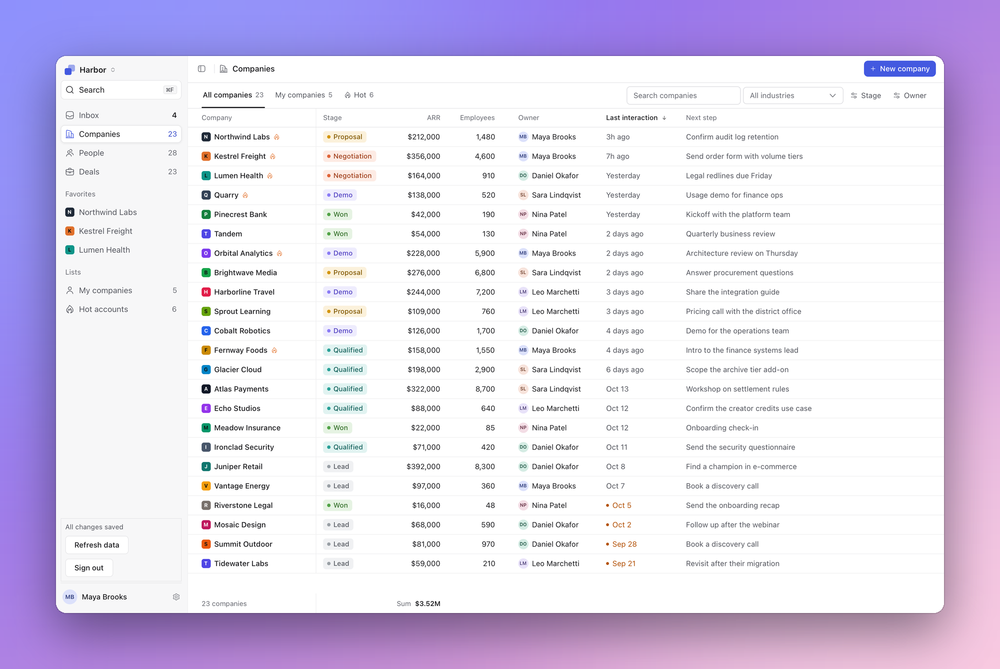
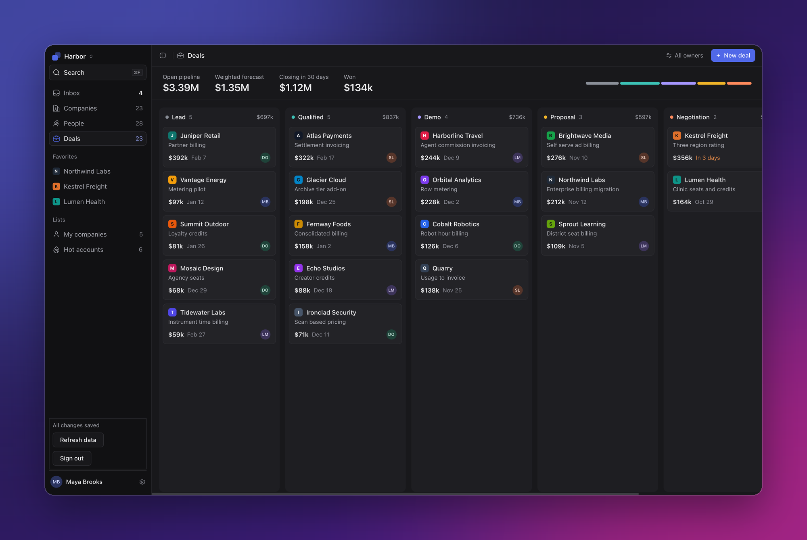
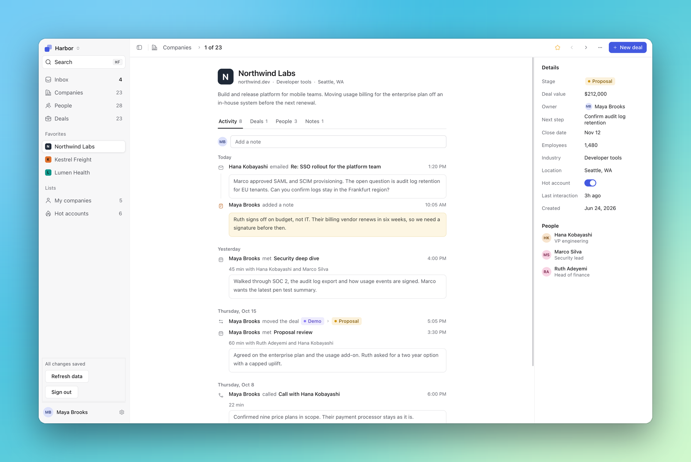
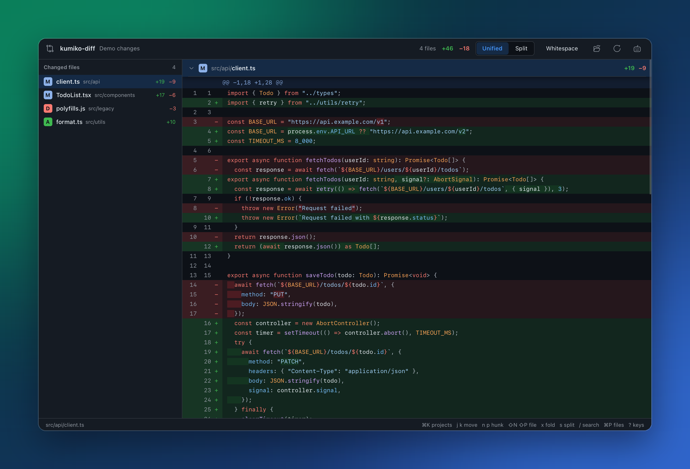
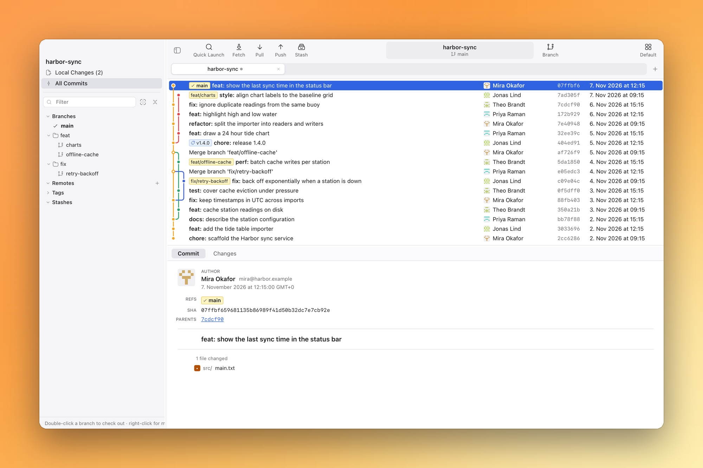
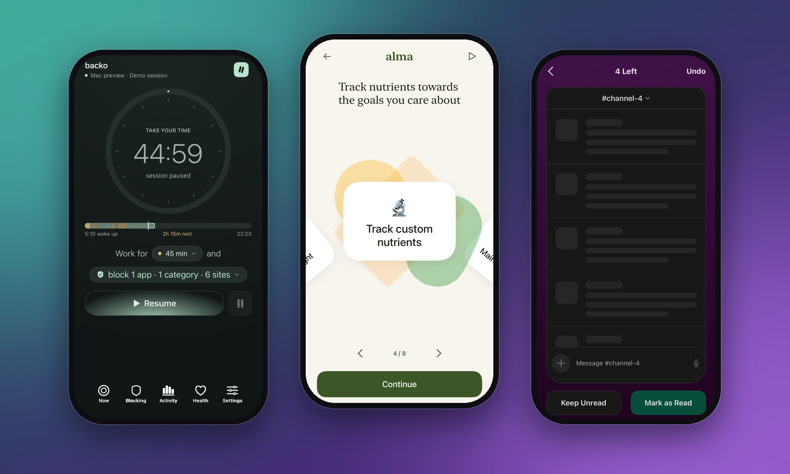

# Kumiko

Native, typed UI for C# 14 and .NET 10, on macOS, Windows, Linux and iOS. No browser, no Electron.



<table>
  <tr>
    <td></td>
    <td></td>
  </tr>
</table>

[CRMLite](examples/CRMLite/README.md): a sortable companies table, a deals
board with drag and drop, a record timeline, light and dark themes.

## Why Kumiko

- **Typed, testable apps.** A model, messages, a pure `Update` and typed
  screens. Analyzers enforce purity and immutable state at build time.
- **Native everywhere.** AppKit + Metal, Win32 + DirectWrite + OpenGL/Direct3D 11,
  GTK + Pango, and real UIKit controls on iOS.
- **Small and fast.** NativeAOT, no runtime install, idle apps sleep in the OS
  event loop. The diff viewer below scrolls a 100k-line diff well inside a
  120 Hz frame.
- **Verifiable without a screen.** Every app renders offscreen to PNG plus a
  semantic tree. E2E suites drive real views with no visible window.

## Examples



| App | What it shows |
| --- | --- |
| [CRMLite](examples/CRMLite/README.md) | Tables, boards, forms, dialogs, settings, desktop integration, plus an [iOS view](examples/CRMLite.iOS/README.md) |
| [Flint](examples/Flint/README.md) | Native Git client: commit graph, staging, branches, remotes, worktrees, Quick Launch |
| [DiffViewer](examples/DiffViewer/README.md) | 120 Hz Git diff viewer with a ⌘K project and worktree palette |
| [DiskMap](examples/DiskMap) | Parallel disk scanner with a treemap view |
| [Workbench](examples/Workbench/README.md) | Editable data grid, search, menus, themes |
| [TraceWaterfall](examples/TraceWaterfall/README.md) | Agent trace timeline with replay |
| [Launcher](examples/Launcher/README.md) | Spotlight-style panel, tray and global shortcut |
| [Components](examples/Components) | Gallery of the built-in controls: forms, data, navigation, overlays |
| [DesktopNotes](examples/DesktopNotes/README.md) | Multi-window app with shared commands |
| [SharedWindows](examples/SharedWindows) | Editor, inspector and settings windows over one shared document |
| [DocumentEditor](examples/DocumentEditor) | Rich-text documents across windows, with save, close prompts and quit |
| [RichTextEditor](examples/RichTextEditor) | The reusable native rich text editor |
| [TypedViews](examples/TypedViews/README.md) | Typed screens and a dialog: sign in, edit, sign out |
| [ReactVite](examples/ReactVite/README.md) | A Vite React app inside a native window, typed IPC |
| [ReactOnly](examples/ReactOnly/README.md) | A whole-window React app calling typed native services |



### iOS



[Focus](examples/Focus.iOS/README.md) and [CapWords](examples/CapWords.iOS/README.md)
run the same Kumiko programs as real UIKit views. `NativeApplication.Run` hosts
the app, with lifecycle messages, state restoration, alerts, action sheets and
context menus. Start a new one with `dotnet new kumiko-ios`. iOS is in
preview.

More iOS examples: [CRMLite.iOS](examples/CRMLite.iOS/README.md) (the CRM on a
phone), [Todo.iOS](examples/Todo.iOS/README.md) (reusable components in a
navigation stack), [Components.iOS](examples/Components.iOS) (control catalog)
and [ML.iOS](examples/ML.iOS/README.md) (Vision text recognition from C#).

## A whole app

```csharp
using Kumiko;
using Kumiko.Runtime;
using Kumiko.UI;

Dev.Run<CounterApp>("Counter", 420, 300, args);

sealed record Model(int Count = 0)
{
    public NavigationHistory<string> Navigation { get; init; } = NavigationHistory<string>.Start("home");
}
abstract partial record Msg
{
    public sealed record Increment : Msg;
    public sealed record Navigate(HistoryRequest Request) : Msg;
}
sealed partial class CounterApp : IKumiko<Model, Msg>
{
    public static Model Init => new();
    public static (Model, Cmd<Msg>) Update(Model m, Msg msg) =>
        (msg switch
        {
            Msg.Increment => m with { Count = m.Count + 1 },
            Msg.Navigate move => m with { Navigation = m.Navigation.Move(move.Request, "app") },
            _ => m
        }, Cmd<Msg>.None);
    public static NavigationRoot<Msg> Root(Model model) => NavigationRoot<Msg>.Create(model.Navigation, "app",
        route => new CounterView(model).Map<Msg>(static message => message),
        static request => new Msg.Navigate(request));
}
sealed class CounterView(Model model) : Screen<Model, Msg>(model)
{
    protected override void Render()
    {
        using var column = C.Div(key: "counter").SizeFull().Center().Gap(Space.S4);
        C.Text(Model.Count.ToString(), Typography.Heading);
        Ui.Button("Increment", new Msg.Increment(), key: "increment");
    }
}
```

`dotnet new kumiko` creates this as a five-file starter.

## Build and run

Install the SDK pinned in [global.json](global.json). NativeAOT on macOS needs
the Xcode Command Line Tools. Linux needs GTK 3 and Pango; Windows needs nothing
extra (WebView2 only for web views).

```sh
dotnet build Kumiko.slnx -c Release
dotnet run --project examples/CRMLite -c Release
dotnet run --project examples/DiffViewer -c Release -- --repo=/path/to/repo
dotnet publish examples/CRMLite -c Release -r osx-arm64 -p:PublishAot=true -o out
```

Publish on the target OS (`win-x64`, `win-arm64`, `linux-x64`, `osx-arm64`, ...).

## Platforms

| | macOS | Windows | Linux |
| --- | --- | --- | --- |
| Window and input | AppKit | Win32 | GTK 3 |
| Rendering | Metal | OpenGL, GDI fallback, opt-in Direct3D 11 | OpenGL, Cairo fallback |
| Text | CoreText | DirectWrite | Pango/HarfBuzz |
| Accessibility | NSAccessibility | UI Automation | ATK / AT-SPI |
| Web view | WKWebView | WebView2 | WebKitGTK |
| Notifications | UserNotifications | WinRT toast | D-Bus |
| Self-update | Signed bundle feed | MSIX and portable zip | Not available |

Also on every desktop: menus, tray, global shortcuts, rich clipboard, drag and
drop, file watching, recent documents, per-monitor DPI, reduce motion and high
contrast, 15 built-in UI languages with right-to-left mirroring. Wayland
shortcuts and the Linux tray are partial.

## Packages

`Kumiko`, `Kumiko.Hosting` (Generic Host and DI), `Kumiko.Icons.Hugeicons`
(6,067 icons) and `Kumiko.Templates` share one version; `Kumiko.iOS` is a
preview package. The public
API is checked at build time.

## Testing

```sh
dotnet run --project tests/Kumiko.E2E -c Release -- artifacts/e2e
dotnet run --project examples/CRMLite -c Release -- --demo --kumiko-snapshot=crm.png
```

E2E suites write PNGs and JSON reports, never show a window and use their own
clipboard. `--kumiko-tree`, `--kumiko-script` and `--kumiko-audit` dump the
semantic tree, drive input and flag inaccessible controls.

The screenshots above were rendered this way on macOS.

## Background

Kumiko is inspired by [nanoui](https://github.com/justrach/nanoui),
[mygo](https://github.com/egoist/mygo) and [Foldkit](https://github.com/foldkit/foldkit).

## License

MIT; see [LICENSE](LICENSE). Some code is adapted from other projects, and their
licenses are in [third_party/licenses](third_party/licenses):

- Kumiko began as a C# rewrite of [nanoui](https://github.com/justrach/nanoui) (MIT).
- Yoga layout ([Yoga.Net](https://github.com/chenrensong/Yoga.Net), MIT) in `src/Kumiko/Yoga`.
- [Hugeicons](https://github.com/hugeicons/hugeicons) free icons (MIT) in `Kumiko.Icons.Hugeicons`.
- Liquid Glass kernels from [mygo](https://github.com/egoist/mygo) (MIT) in `Rendering/Glass.cs` and `Rendering/MetalShader.cs`.
- Element styling, list and shadow techniques from [GPUI](https://github.com/zed-industries/zed/tree/main/crates/gpui) (Apache 2.0).
